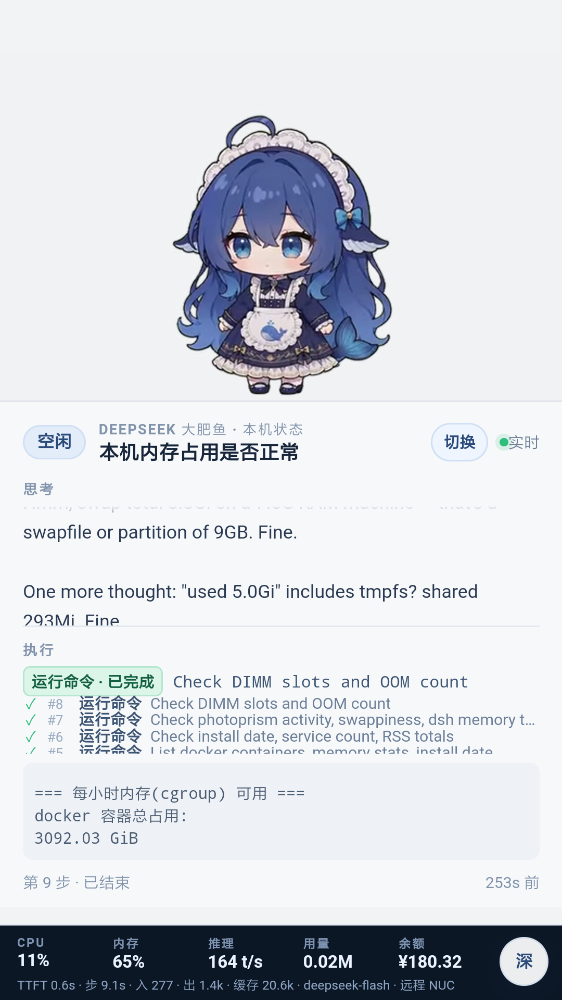

# dsh-pet · Android Indicator / 手机鲸鱼娘

把 [dsh-pet](https://github.com/PC2005-cloud/dsh-pet) 的鲸鱼娘动画搬进 Android 全屏壳，并把本机 DSH 的思考、执行步骤、CPU/内存/推理/余额实时投到手机下半屏。

> **动画素材出处**：本项目使用的 106 段鲸鱼娘动画来自 **[PC2005-cloud/dsh-pet](https://github.com/PC2005-cloud/dsh-pet)**（MIT License，Copyright © 2026 PC2005-cloud）。感谢作者做出这么可爱的桌宠，以及开放 MIT 许可。本项目只是独立的 Android / 服务器壳，与上游无隶属关系；上游许可见 [`LICENSE.dsh-pet`](LICENSE.dsh-pet)，完整鸣谢见 [`CREDITS.md`](CREDITS.md)。



## 功能

- **上 2/5**：鲸鱼娘动画；摸她会播爱心回应，思考/工作/完成/出错各有动作。
- **下 3/5**：当前会话、状态、最近思考、执行中的工具步骤（最近 4 个，✓/●/×）、工具输出。
- **底部遥测**：CPU、内存、推理 tok/s、本轮用量（M）、DeepSeek 余额；下面一行 TTFT / 步耗时 / 入出 / 缓存 / 模型 / 远程主机。
- **多会话**：默认跟随最后收到提问的会话；右上角「切换」可固定，12 小时内有提问的会话最多 12 个。
- **浅色 / 黑灰**：右下角一键切换，主题和动画资源都各有两套。
- **碎碎念**：她头顶会按状态和情境冒一句拟人化短话（CPU 高、卡太久、深夜、第 20 步等）。
- **首次离线**：App 第一次启动把 106×2 段动画下载到手机，显示进度；之后视频全走本机 `127.0.0.1`，不再占局域网带宽。
- **执行日志**：每次动画切换记 JSONL，可查 `/api/anim-log`。

## 目录

```
.
├── server.mjs              # Node 22+，零依赖：会话解析、遥测、余额、资源清单、静态服务
├── start.sh / stop.sh
├── public/                 # WebView 页面：index.html / pet.js / pet.css / animations.json
├── assets/                 # dsh-pet 原始透明 WebM，106 段 640×360@24（MIT，见 LICENSE.dsh-pet）
├── tools/                  # 烘焙浅色/黑灰 MP4、批量放大
├── android/                # 全屏 WebView 壳 + 首次下载 + 本地 HTTP 服务
│   ├── app/src/.../MainActivity.java
│   ├── app/res/
│   ├── tools/build.sh
│   └── tools/build-on-debian.sh
├── docs/quality-analysis.md
└── preview-*.png
```

生成后的 `assets-light/`、`assets-dark/`、`assets-hd/`、`android/build/`、`android/dist/`、`.token`、`url.txt`、`data/` 不入库。

## 快速开始

### 1. 依赖

- Node.js **22+**（服务端，无 npm 依赖）
- FFmpeg（烘焙 MP4）
- Python 3（批量脚本）
- Android 构建另需 JDK 17 + Android SDK 34（见下）

### 2. 生成动画资源

服务端和 App 用的不是原始 WebM，而是烘焙了背景的 H.264：

```bash
cd dsh-pet-screen

# 浅色 #f2f3f5，1280×720
python3 tools/light_mp4.py --all --workers 4

# 黑灰 #191d23，1280×720
python3 tools/dark_mp4.py
```

> 素材源是 **640×360@24fps**，放大到 720/1080 不会凭空增加细节；更高分辨率只是让缩放更干净。想用 1080p，可把脚本里的 `1280:720` 改成 `1920:1080`，在性能更好的机器上跑。

### 3. 启动服务

```bash
PORT=39100 ./start.sh
cat url.txt        # 首次启动会生成带 token 的地址
```

手机和电脑同一局域网，浏览器打开：

```text
http://<电脑IP>:39100/?t=<token>
```

默认是 2/5 + 3/5 仪表盘；`?layout=full` 回到全屏动画，`?playlist=1` 顺序看全部 106 段，`?anim=<名字>` 只看一段。

### 4. Android 壳

```bash
cd android
DSH_DEFAULT_URL="http://<电脑IP>:39100/?t=<token>" ./tools/build.sh
# 或用 Debian 远程编译，NUC 只收 APK：
./tools/build-on-debian.sh
adb install -r dist/WhaleScreen-1.0.apk
```

首次启动会请求 `/api/assets`，把 212 段（浅/深两套，约 517MB）下到 App 私有目录并显示进度，随后由 App 内 `127.0.0.1` 本地 HTTP 服务提供视频。之后只有 `/api/status` 等小请求走局域网。

## 配置

| 项 | 说明 |
|---|---|
| `PORT` | 服务端口，默认 `39100` |
| `~/.dsh/sessions` | DSH 会话目录；服务只读尾部事件 |
| `DEEPSEEK_API_KEY` | 读 `~/.dsh/dsh-web.env`；用于 `/api/balance`，没有则余额显示 `—` |
| `.token` | 首次启动自动生成；删除后重启换 token |
| 系统服务 | `dsh-pet-screen.service` 是 systemd 模板，按实际路径/用户修改 |

## 主题与 AMOLED 纯黑

- 右下角按钮按 **浅色 → 黑灰 → AMOLED 纯黑** 循环。
- 设置里的「AMOLED 纯黑」开关开启后，页面背景、状态卡、底栏、会话面板、碎碎念全部压到 `#000`，视频用单独的 `assets-amoled/`（1280×720，full-range H.264），避免普通 limited-range 视频在纯黑屏上显示成深灰。
- 三个主题的素材：`assets-light`、`assets-dark`、`assets-amoled`；App 首次同步会一起下载。

## 界面与配置

- 顶栏左上角显示本机时间，右上角显示电池百分比（充电时带 ⚡）。
- 顶栏齿轮打开 App 原生配置：服务器 IP / 端口 / token、主题、碎碎念开关；保存后自动重连并检查本地动画版本。
- 任务结束后「执行」区自动隐藏，右下角 `Xs 前` 计时停止；只有 `thinking / working / waiting` 才显示。
- 底栏遥测跟随浅色/黑灰主题切换；CPU / 内存采样为 **5 秒一次**，状态和步骤仍按 150–200ms 刷新。
- 全量 212 个视频（106 段 × 浅/深）已全部替换为 Real-ESRGAN 2×（640×360 → 1280×720）版本，不再限制只播核心段。

## 已知限制

- 动画源只有 **640×360 / 24fps**；重转码只能改善缩放边缘，不能真正提高源细节或帧率。
- Android 8 / WebView 71 不支持透明视频，所以用浅色/黑灰两套烘焙底，而不是 alpha。
- 首次离线下载约 517MB（两套 1080p）；如果只要一套，可删掉 `assets-dark` 并改 `/api/assets`，或只用浅色。
- 页面和状态仍需要局域网服务；App 断网时只能显示已下载动画，状态区不可用。

## 开发记录

- [画质 / 帧率分析](docs/quality-analysis.md)
- 服务端实现：zstd 尾部解码、会话选择、工具/结果解析、资源清单、本地 Range 服务。
- 动画日志：`GET /api/anim-log?t=<token>`，或 `data/anim.log`。

## 致谢

- **[PC2005-cloud/dsh-pet](https://github.com/PC2005-cloud/dsh-pet)**：106 段鲸鱼娘动画、动作分类与原始桌宠实现，MIT License。没有这个项目就没有这个壳。
- **DeepSeek Harness (DSH)**：会话事件格式与本机状态来源。
- 图标由 dsh-pet 的「点击回应-开心跃动」帧重新排版生成。

完整说明见 [`CREDITS.md`](CREDITS.md)。本项目代码以 MIT License 发布（见 [`LICENSE`](LICENSE)）；上游动画素材仍遵循其 MIT 许可与版权声明。
